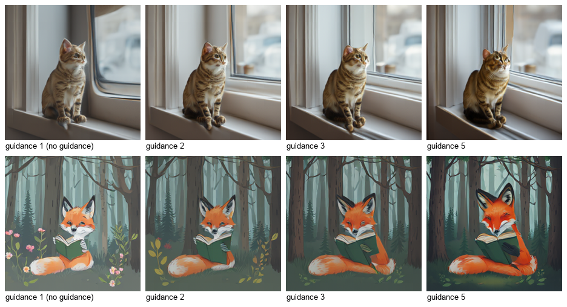

# Scale-RAE for ComfyUI

Text-to-image in ComfyUI with the official **Scale-RAE** model
([ZitengWangNYU/Scale-RAE](https://github.com/ZitengWangNYU/Scale-RAE), paper
[arXiv:2601.16208](https://arxiv.org/abs/2601.16208), *Scaling Text-to-Image Diffusion Transformers with Representation
Autoencoders*). A Qwen2.5-1.5B language model reads the prompt, a 2.4B rectified-flow DiT samples the image in the feature space of a
vision encoder, and an RAE decoder turns those features into pixels. Everything runs **inside the ComfyUI process**; the nodes never
download anything.

> **Unofficial.** This node pack is an independent integration. It is not affiliated with or endorsed by the Scale-RAE authors
> (New York University), by Meta, by Alibaba (Qwen) or by Comfy Org.
>
> 日本語の概要は [README.ja.md](README.ja.md) にあります。


## What it does

| Node | Purpose |
| --- | --- |
| **Scale-RAE Loader** | Picks the generator and the RAE decoder folder from `models/scale_rae`, the dtype, the device and a keep-loaded switch |
| **Scale-RAE Text to Image** | Prompt, seed, guidance, sampling steps, batch size → `IMAGE` (224 x 224) and a JSON report |
| **Scale-RAE Unload** | Frees the resident model (GPU and RAM) |

Supported model: **`nyu-visionx/Scale-RAE-Qwen1.5B_DiT2.4B-WebSSL`** with **`nyu-visionx/webssl300m_decoder`** (the WebSSL variant;
224 x 224 output). The SigLIP-2 variants of the official collection are not supported yet.

## How far it was checked

Windows 11, RTX 5090 (32 GB), ComfyUI v0.38.0 (details and raw numbers in [docs/VERIFICATION.md](docs/VERIFICATION.md)):

- **Bit-identical to the official code.** In the official environment (Python 3.10, torch 2.8.0, transformers 4.37.0), 7 of 7 jobs
  (4 prompts, seeds 42 / 7 / 123, guidance 1 and 3, one repeat) give the same image *and* the same 256 x 1024 latent as the official
  `inference/cli.py` code path, byte for byte. The prompt template and token ids equal the official ones for 5 test prompts (English,
  Japanese, emoji, whitespace, special tokens).
- **Real ComfyUI queue:** in a ComfyUI environment with torch 2.14.1 and transformers 5.20.1 the queue gives the same images as the
  pack's in-process run (7 of 7, also in reverse order and after reloading); against the official run in the other environment the
  images differ by at most 1 of 255 per pixel (PSNR 65 dB or more), which is the library versions.
- **Real jobs:** float32 / float16 / bfloat16, CPU, batches, the three `image_start` modes, guidance in both modes, text-only answers,
  interrupt, unload and keep-loaded off, all with the real weights.
- **Clean install:** fresh ComfyUI v0.38.0, fresh Python 3.12 environment, `git clone` of this repository, `pip install -r
  requirements.txt`, the decoder downloaded with `tools/download_models.py` (SHA-256 verified): the seven jobs above give the same
  images as the development environment (7 of 7), and both shipped workflows run unchanged.
- **CI** (GitHub Actions; Ubuntu and Windows; transformers 4.50.3 and latest; Python 3.10 and 3.12): CPU tests with a tiny random
  model in the official file layout, the vendored code compared byte for byte with the pinned upstream commit, the prompt ids
  compared with the official ones, and a real ComfyUI queue on the CPU. CI does not download the weights (about 17.6 GB).

**Not checked:** Linux or macOS with a GPU, AMD / Apple GPUs, GPUs with less than about 10 GB, other ComfyUI versions, and image
quality against the paper's benchmarks (the pack reproduces the official outputs; it does not re-evaluate the model).

## Install

1. ComfyUI with the V3 node API (**v0.38.0** was used), Python 3.10+, an NVIDIA GPU with about 18 GB of free VRAM for float32 or
   about 10 GB for float16 / bfloat16 (the CPU works, slowly).
2. Put this folder into `ComfyUI/custom_nodes/` (or install it from the ComfyUI Manager / Comfy Registry once listed) and install its
   requirements into ComfyUI's Python:

   ```
   python -m pip install -r custom_nodes/ComfyUI-ScaleRAE/requirements.txt
   ```

   That is `transformers>=4.50.3`, `timm`, `einops` and `safetensors` (ComfyUI already has most of them).
3. Download the generator and the decoder (about 17.6 GB together; both model cards say MIT) into `models/scale_rae/`:

   ```
   python custom_nodes/ComfyUI-ScaleRAE/tools/download_models.py --models-dir ComfyUI/models/scale_rae
   ```

   This fetches `Scale-RAE-Qwen1.5B_DiT2.4B-WebSSL` and `webssl300m_decoder` at the revisions this pack was verified with and checks
   the SHA-256 of every file (`--verify-only` checks existing folders). The Loader lists a folder only if it has the right files
   (`config.json` with `"model_type": "cambrian_qwen"` plus the safetensors and tokenizer files, or `"model_type": "vit_mae"` plus
   `model.pt`). The WebSSL **encoder** is not needed and is not downloaded (see *Licenses*).
4. Restart ComfyUI and load a workflow from `workflows/gui/` (or `workflows/api/`).

## Using the nodes

- **Prompts.** The language model is a chat model. Requests such as *"Can you generate a photo of ...?"*, *"Can you create an image of
  ...?"* or *"Generate an image of ..."* make it write a short reply ("Here's the image you requested:") and start the image itself —
  the official path. **Plain descriptions** ("A field of sunflowers") make it answer with text only: 0 of 20 plain descriptions
  started an image, 60 of 60 requests did (20 subjects x 3 phrasings). Requests are not a guarantee: *"Can you generate a
  close-up photo of a bowl of ramen?"* was answered with text. The outcome does not depend on the seed (the text is decoded greedily).
- **image_start** handles that: `auto` (default) takes the official path and, after a text-only answer, starts the image right after
  the prompt with the same seed (the report shows `image_forced: true` and the text it skipped; this costs the time of the text, a
  few seconds); `model` is the official behaviour only (a text-only answer is an error); `force` always starts the image right after
  the prompt. For request prompts `force` gives images very close to the official ones (same noise, slightly different conditioning).
- **guidance / cfg_mode.** Guidance 1.0 (default) is the official default and what the paper's evaluation uses. In the released code
  a guidance above 1 has **no effect** (its default `cfg_interval` makes the guidance step return the conditional prediction; upstream
  issue [#7](https://github.com/ZitengWangNYU/Scale-RAE/issues/7)): that is `cfg_mode = official-cli`. `cfg_mode = standard` (default)
  applies classifier-free guidance at every step, which makes images darker and more saturated as guidance grows:

  

  Guidance above 1 runs the DiT on two rows and takes about 1.7 times as long.
- **dtype.** `float32` matches the official code. `float16` needs about half the VRAM and stayed close to float32 (PSNR 37 to 56 dB
  on 7 jobs); `bfloat16` needs the same memory but changed images more (26 to 33 dB, and sometimes the model's short reply). The RAE
  decoder always runs in float32: in float16 it overflowed and every image came out as the same flat picture. The CPU always runs
  float32.
- **seed / batch_size.** Same model, prompt, settings, seed and environment give the same image. A batch uses seeds `seed`,
  `seed + 1`, ...; image *k* of a batch equals a single run with seed `seed + k`. CPU and GPU draw different noise for the same seed,
  so their images differ.
- **steps** (default 50, the official and paper setting) is the number of Euler steps of the flow sampler.
- The **report** (STRING output) has the seed, guidance, mode, the model's text before the image, time and peak VRAM of each image.
- Output size is fixed at 224 x 224 by the WebSSL decoder; use an upscaler node for larger images.

## Measured on this setup

RTX 5090, Intel Core Ultra 9 285K, 64 GB RAM, Windows 11, torch 2.14.1+cu130, transformers 5.20.1, 50 steps:

| dtype | load | per image, guidance 1 | per image, guidance > 1 | peak VRAM (allocated) |
| --- | --- | --- | --- | --- |
| float32 | 11.5 to 12 s | 2.2 to 2.8 s | 3.8 to 4.1 s | 17.4 GiB |
| float16 | 11.5 s | 1.4 to 2.4 s | 2.3 to 2.4 s | 9.5 GiB |
| bfloat16 | 11.5 s | 1.4 to 2.6 s | 2.3 to 2.4 s | 9.5 GiB |
| float32 on the CPU | 3 s (files cached) | 52 s | not measured | — |

Loading reads the 16 GB float32 checkpoint (the files were in the OS cache; from disk it takes longer). Windows commit charge rose by
about 22 GiB during loading and stayed about 17 GiB higher while the model was resident, although the process's working set was
about 3 GiB; with the default pagefile settings a machine needs room for that.

## Notes and limits

- **Language model.** `scale_rae_comfy/qwen2.py` is a plain PyTorch Qwen2 stack that reproduces the transformers 4.37 code path the
  official model uses (float32 RMSNorm, rotary tables, SDPA without a mask, tied embeddings). The official code needs transformers
  4.37, which ComfyUI cannot use; this keeps the numerics independent of the installed transformers version.
- **Vendored code.** The DiT head and the decoder are the official modules (`scale_rae_comfy/vendor`, commit `dab3800`); two files have
  documented comment / import edits so that they import under transformers 5 and contain no environment-variable or network code
  ([UPSTREAM.md](scale_rae_comfy/vendor/UPSTREAM.md)). The test suite checks every byte against the upstream commit.
- **Guidance in the official CLI.** `--guidance-level` of the official CLI has no effect (see above); `cfg_mode = official-cli`
  reproduces that exactly, `standard` is what the option name suggests.
- The model sometimes writes text inside the picture as garbled letters, as other image models of its size do.

## Licenses

- This node pack's code: **MIT** ([LICENSE](LICENSE)); third-party notices in [NOTICE](NOTICE).
- `scale_rae_comfy/vendor/scale_rae`: from the official repository, **MIT** (`scale_rae_comfy/vendor/LICENSE`); it contains code
  derived from OpenAI's diffusion repositories and BAAI's EVA-02 (MIT) and from the Hugging Face ViTMAE model (Apache-2.0).
- Model weights are **not included**: the generator and the decoder are MIT according to their model cards; the generator's
  language model is fine-tuned from Qwen2.5-1.5B-Instruct. The decoder reconstructs images from the feature space of Meta's WebSSL
  encoder (`facebook/webssl-dino300m-full2b-224`), whose weights are **CC-BY-NC-4.0**. This pack neither downloads nor runs that
  encoder, but the model cards do not say whether its non-commercial terms extend to models trained on its features; check before
  any commercial use.
- ComfyUI (GPL-3.0) hosts the nodes; PyTorch, transformers, timm and einops keep their own licenses.

## Development

```
pip install pytest ruff                                   # plus ComfyUI's requirements
SCALE_RAE_COMFYUI_DIR=... SCALE_RAE_UPSTREAM_DIR=... SCALE_RAE_TOKENIZER_DIR=... python -m pytest tests
python scripts/ci_queue_check.py --comfyui <ComfyUI> --tokenizer-dir <tokenizer files>   # real queue on the CPU, tiny model
python scripts/run_jobs.py --model <generator folder> --decoder <decoder folder> --jobs jobs.json --out <dir>
python scripts/queue_jobs.py --server http://127.0.0.1:8188 --comfy-output <ComfyUI/output> --jobs jobs.json --out <dir>
python scripts/compare_runs.py <dir A> <dir B>
```

`scripts/vendor_sync.py --upstream <checkout>` rebuilds the vendored folder and its manifest from an upstream checkout (`--check`
only compares). The tokenizer files for the tests are the five small files listed in `tests/tokenizer_files.sha256`.

## Citation

If you use Scale-RAE, please cite the authors (BibTeX in the upstream README, arXiv:2601.16208).
